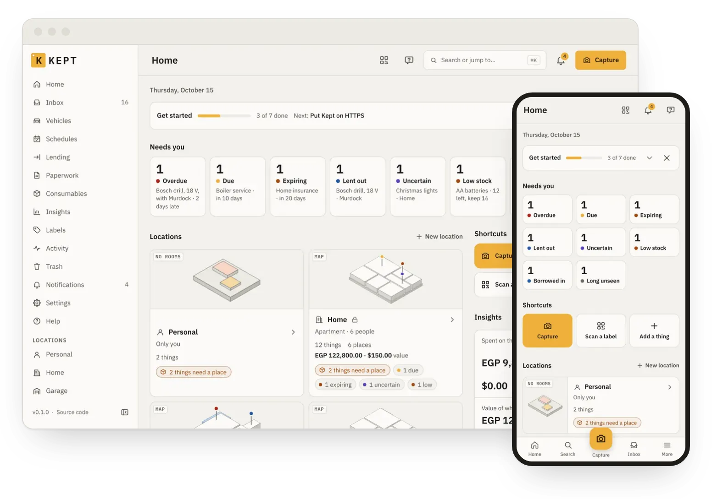
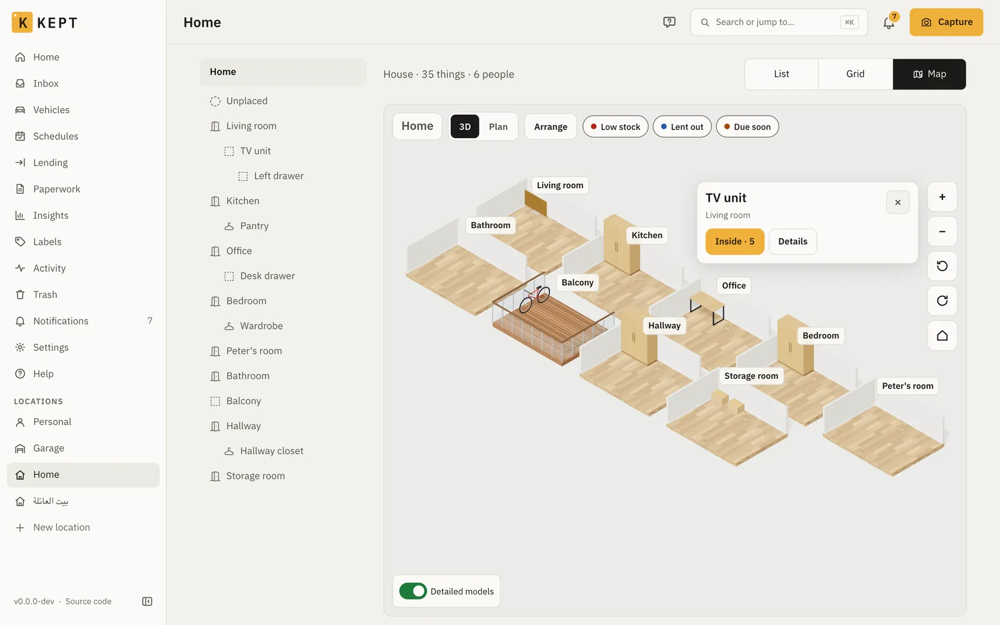
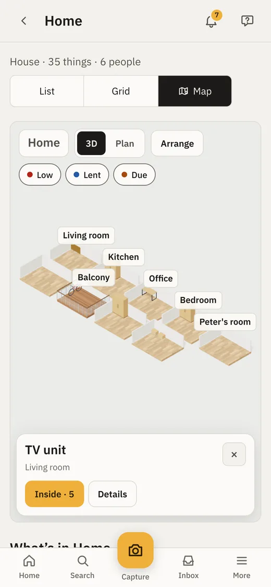
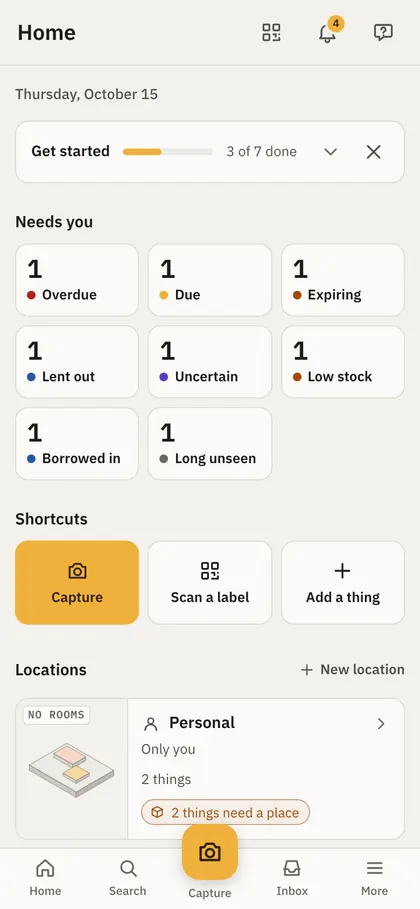
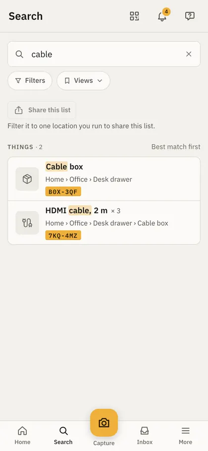
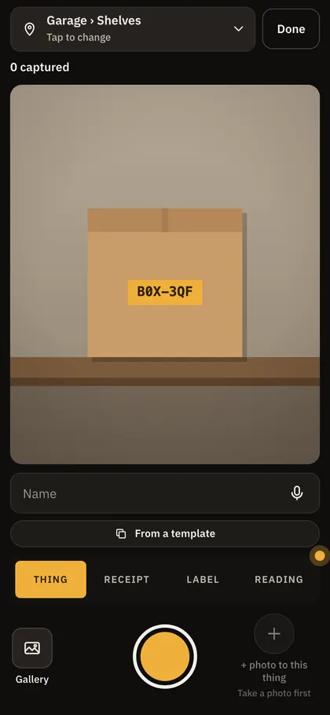
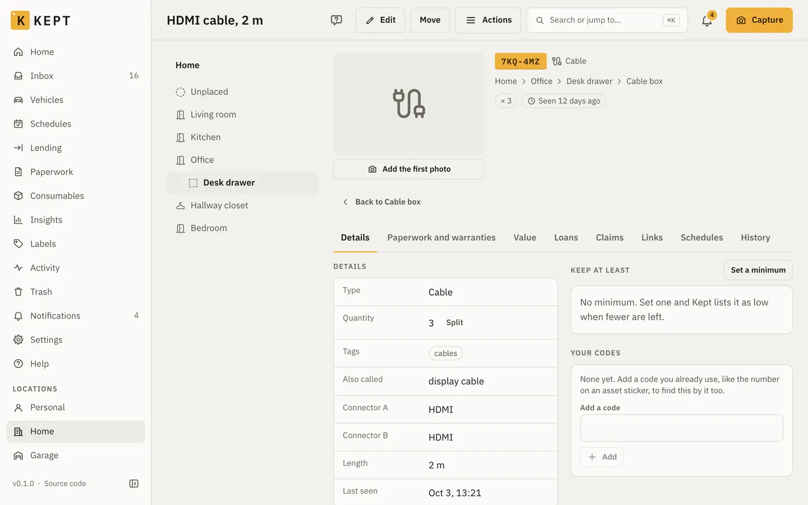
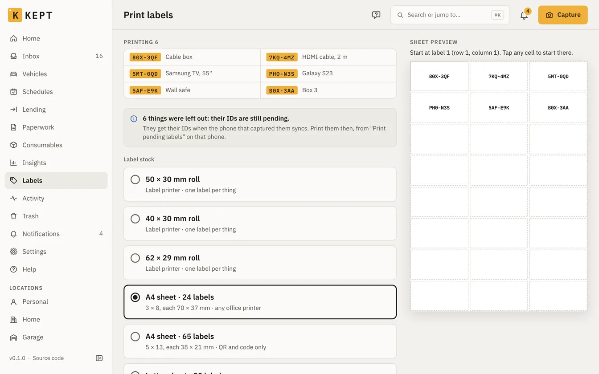
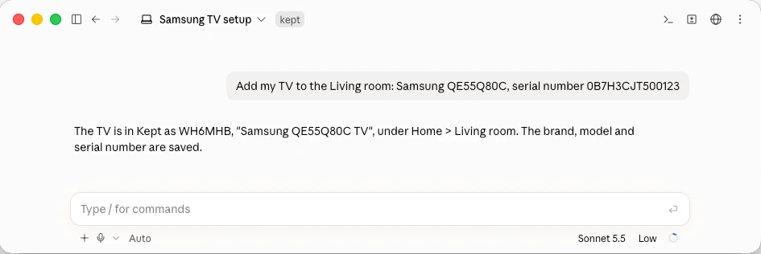
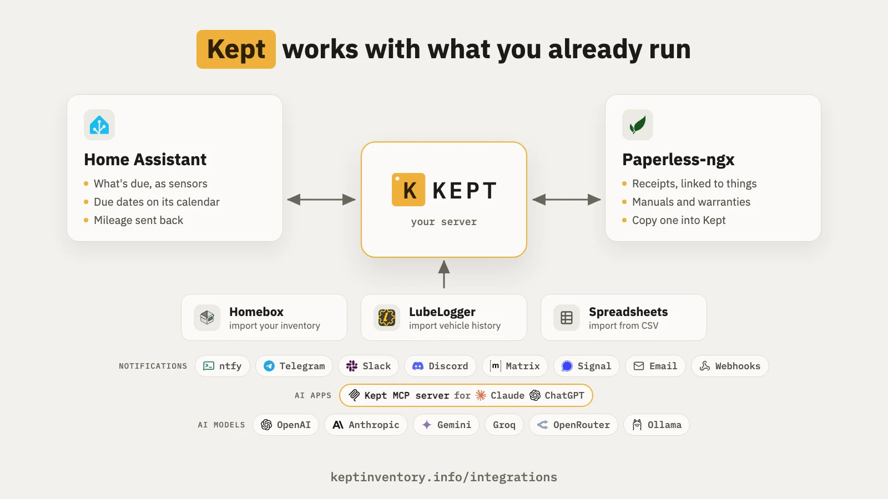

<p align="center">
  <picture>
    <source media="(prefers-color-scheme: dark)" srcset="docs/assets/kept-lockup-dark.svg">
    
  </picture>
</p>

<p align="center">
  A self-hosted, open-source inventory of everything you own and where it is,<br>
  with its paperwork and its history.
</p>

<!--
  One style for every badge: flat-square, the kit's ink-2 (#55524C) label and amber (#F0B03A)
  value (apps/web/src/styles/tokens.css). Release and CI are live (shields.io reads GitHub): CI
  turns red when the ci workflow fails on main. Both read public data, so they render once the
  repository is public.
-->
<p align="center">
  <a href="https://github.com/keptinventory/kept/releases/latest"></a>
  <a href="https://github.com/keptinventory/kept/actions/workflows/ci.yml"></a>
  <a href="LICENSE"></a>
  <a href="https://keptinventory.info/"></a>
  <a href="https://github.com/orgs/keptinventory/packages/container/package/kept"></a>
  <a href="CONTRIBUTING.md#sign-the-cla-once-and-sign-off-every-commit"></a>
</p>

<p align="center">
  <a href="https://keptinventory.info/try/kept/"><b>Try Kept</b></a> ·
  <a href="https://keptinventory.info/try/map/"><b>Try the map</b></a> ·
  <a href="#quick-start-host-it"><b>Host it</b></a> ·
  <a href="https://keptinventory.info/"><b>Docs</b></a>
</p>

<p align="center">
  <picture>
    <source media="(prefers-color-scheme: dark)" srcset="docs/assets/kept-hero-dark.webp">
    
  </picture>
</p>

Homes, garages and storage units; the rooms, shelves and boxes inside them; the things inside
those, with receipts, manuals, warranties and history. Self-hosted, on your own server or homelab.
Nothing leaves it unless you turn it on: no telemetry, the update check off by default, the AI
provider yours to choose.

## Try it in your browser

Nothing to install, nothing saved.

- **[Try Kept](https://keptinventory.info/try/kept/):** the whole app, with a sample household.
- **[Try the map](https://keptinventory.info/try/map/):** the 3D map, with a sample home.

## A look around

### The location map

Each location as a 3D map: floors, rooms, shelves and boxes, what's inside one tap away. Arranged
by you, or laid out by Kept. Plan view, balconies and terraces, phones included
([the map](https://keptinventory.info/users/location-map/)).

<p align="center">
  <picture>
    <source media="(prefers-color-scheme: dark)" srcset="apps/docs/src/assets/screens/map-desktop-dark.webp">
    
  </picture>
  
</p>

### On a phone

Installs as an app. Capture, scan and search, offline too.

<p align="center">
  <picture>
    <source media="(prefers-color-scheme: dark)" srcset="apps/docs/src/assets/screens/phone-dark.webp">
    
  </picture>
  <picture>
    <source media="(prefers-color-scheme: dark)" srcset="apps/docs/src/assets/screens/search-phone-dark.webp">
    
  </picture>
  <picture>
    <source media="(prefers-color-scheme: dark)" srcset="apps/docs/src/assets/screens/capture-phone-dark.webp">
    
  </picture>
</p>

### A thing

A short ID, where it is down to the box, its details, paperwork, value, loans and history.

<p align="center">
  <picture>
    <source media="(prefers-color-scheme: dark)" srcset="apps/docs/src/assets/screens/thing-dark.webp">
    
  </picture>
</p>

### Labels

A short ID and a QR code for every box. Label-printer rolls or office-printer sheets; scan one to
open the box.

<p align="center">
  <picture>
    <source media="(prefers-color-scheme: dark)" srcset="apps/docs/src/assets/screens/labels-dark.webp">
    
  </picture>
</p>

## What it does

- **Inventory.** Locations, places, boxes and things, with photos, documents, tags, custom fields,
  quantities, saved views, search and a trash you can restore from.
- **Capture.** Photograph a thing, a receipt or a label, online or offline; your AI provider
  (OpenAI, Anthropic, Google, OpenRouter, Groq, or an OpenAI-compatible server such as Ollama)
  suggests the details and you confirm them. Without one, you type them.
- **Labels.** Print label sheets with a short ID and a QR code; scan one to open the box it is on.
- **The household.** Shared locations with roles, lending, schedules, warranties, paperwork and an
  insurance report; reminders in the app, by mail, by push and in a calendar feed.
- **Moving house.** Numbered boxes, a label and a contents sheet for each, tracked in the van,
  unpacked by scanning ([moving](https://keptinventory.info/users/moving/)).
- **Vehicles and machines.** Readings, services, fuel and running costs.
- **AI assistant and MCP server.** Ask in plain words; changes wait for your OK. Claude and other
  AI agents connect at `/mcp` ([how](https://keptinventory.info/users/mcp-clients/)).
- **Backups you can read.** Nightly restic backups to a directory, S3 or SFTP, each with a copy
  that opens in a browser without Kept; imports from Homebox and CSV, full exports.
- **Five languages:** English, Arabic (right to left), French, German and Italian.

<p align="center">
  
</p>

## Quick start: host it

Docker with Compose v2, on a machine with at least 2 GB of RAM and 2 CPU cores
([what it needs](https://keptinventory.info/install/hardware/)).

```sh
git clone --branch v1.10.5 --depth 1 https://github.com/keptinventory/kept.git && cd kept
cp compose.env.example .env
for v in SUPERUSER OWNER APP AUTH SYSTEM; do
  sed -i.bak "s/^KEPT_DB_${v}_PASSWORD=\$/KEPT_DB_${v}_PASSWORD=$(openssl rand -hex 32)/" .env
done
sed -i.bak 's|^KEPT_IMAGE=$|KEPT_IMAGE=ghcr.io/keptinventory/kept:1.10.5|' .env && rm .env.bak
# Set KEPT_PUBLIC_URL in .env to the address you will open, e.g. http://<this host>:8080
docker compose pull
docker compose up -d
docker compose logs kept | grep "KEPT SETUP CODE"
```

1. **`.env`:** five generated database passwords, the released image, and `KEPT_PUBLIC_URL`:
   exactly the address the browser shows (links and QR codes are built from it).
2. **Start:** the database, then the one-shot `migrate`, then Kept on port 8080
   (`KEPT_HTTP_PORT` changes it).
3. **First run:** open `KEPT_PUBLIC_URL`, enter the setup code from the log, create the first
   account. It becomes the instance admin.
4. **Keep the keys:** `docker compose exec kept kept admin recovery-kit` prints them. Store them
   off this server: a backup restores secret values only with the key.

The camera, installing the app, push and location need HTTPS:
`docker compose --profile https up -d` adds Caddy with a certificate for `KEPT_DOMAIN`
([HTTPS](https://keptinventory.info/install/https/)). Every step in full:
[the install guide](https://keptinventory.info/install/compose/).

- **Kubernetes:** the Helm chart, `oci://ghcr.io/keptinventory/charts/kept`, signed and published
  with each release ([install on Kubernetes](https://keptinventory.info/install/kubernetes/)).
- **Verify the image:** `cosign verify --key cosign.pub <image>:<version>`, with `cosign.pub` from
  this repository ([verifying a release](https://keptinventory.info/admin/verify-release/)).
- **Backups:** nightly, encrypted, to a directory, S3 or SFTP
  ([backups](https://keptinventory.info/admin/backups/)).

## Works with

<p align="center">
  <a href="https://keptinventory.info/integrations/"></a>
</p>

- **Home Assistant:** the [kept-homeassistant](https://github.com/keptinventory/kept-homeassistant)
  integration, a HACS custom repository ([setup](https://keptinventory.info/users/home-assistant/)).
- **Paperless-ngx:** receipts, manuals and warranty cards linked to things
  ([setup](https://keptinventory.info/users/paperless/)).
- **The rest:** [integrations](https://keptinventory.info/integrations/).

## Links

| | |
|---|---|
| Documentation | [keptinventory.info](https://keptinventory.info/) |
| Install | [Docker Compose](https://keptinventory.info/install/compose/), [HTTPS](https://keptinventory.info/install/https/), [Kubernetes](https://keptinventory.info/install/kubernetes/) (Helm chart in [`charts/kept`](charts/kept/)), [configuration](https://keptinventory.info/reference/configuration/) |
| API | [HTTP API reference](https://keptinventory.info/api/), generated from the OpenAPI document |
| MCP | [Connect an AI client](https://keptinventory.info/users/mcp-clients/) |
| Roadmap | [What's planned, in progress and shipped](https://github.com/orgs/keptinventory/projects/1) |
| Questions and ideas | [Discussions](https://github.com/keptinventory/kept/discussions) |
| Contributing | [CONTRIBUTING.md](CONTRIBUTING.md): a discussion or an issue first for anything larger than a fix; [the CLA once, a sign-off on every commit](CONTRIBUTING.md#sign-the-cla-once-and-sign-off-every-commit) |
| Security | [SECURITY.md](SECURITY.md): report privately, never in a public issue |
| Changelog | [CHANGELOG.md](CHANGELOG.md) |

## Licence

Kept is free software under the GNU Affero General Public License, version 3
([`LICENSE`](LICENSE)), and every feature ships in it: nothing is held back. If you run a modified
Kept for other people, you must offer them its source. The image carries the third-party notices
of everything inside it, served at `/notices.txt`.
