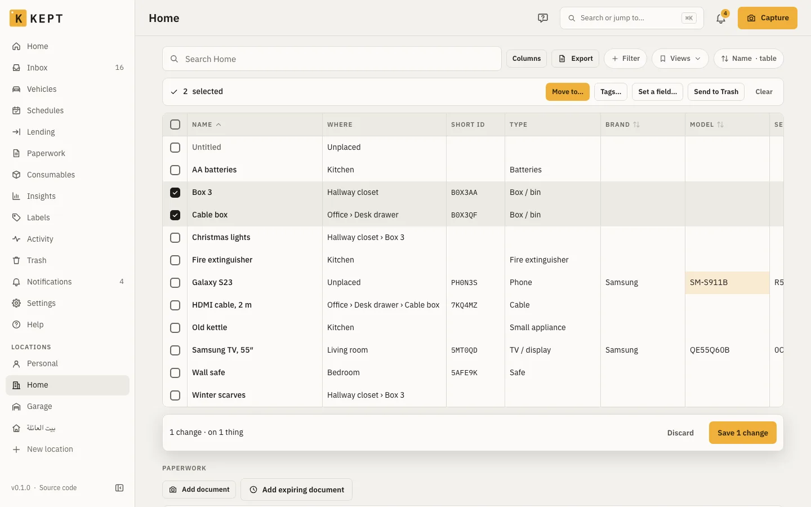
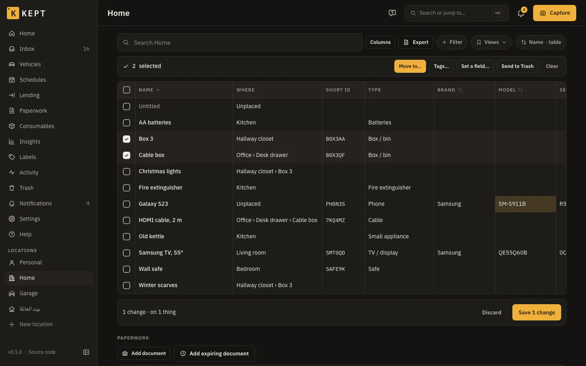

Kept answers three questions about everything you own: where it is, what paperwork it has, and
what it needs next. This page walks through the screens that do that. Which of them you see
depends on your role and on what each location tracks
([presets and roles](/users/first-run/#3-create-your-first-home)). To click through them before
installing, [try Kept](/try/kept/) with a sample household in your browser.

## Home

Home is what needs you, then where things are. On a phone it is one column in this order; on a
computer, locations and recent activity sit on the left, shortcuts and Insights on the right.

- **Get started**: one line with your progress and the next step. The arrow opens the steps;
  **×** hides it for good (Undo in the message; **Help → Get-started checklist** brings it back).
  It goes away by itself when every step is done.
- **Needs you**: six counts, always in the same place: **Overdue**, **Due**, **Expiring**, **Lent
  out**, **Uncertain** and **Low stock**. A zero is greyed out, not hidden. **Borrowed in** and
  **Long unseen** appear when they have something. On a computer each one names its most urgent
  item. Tap one to open that list, already filtered. Lent out shows where Lending is on, Low
  stock where Consumables is on.
- **Shortcuts**: **Capture**, **Scan a label**, **Log a reading** (when something has a meter)
  and **Add a thing**.
- **Locations**: a card per location with a small map drawing, its things, places and value
  (where Money is on and you can see amounts), and what is flagged there, such as "2 things need
  a place" or "1 overdue". Tap a card to open the location.
- **Recent activity**: the latest 3 on a phone, 5 on a computer; **Added**, **Moved** and
  **Checked** narrow them, and **All activity** opens the full list. **Photos to review** shows
  what waits in the Inbox.
- **Insights** (where Money is on): what you spent on things this year so far, with the years
  before it, and the value of what you own. Each currency on its own line, never converted. It
  says which locations it leaves out.

On your first day Home shows the welcome, **Create your first home** with the steps after it,
your Personal location, and the shortcuts that already work.

## Locations, rooms and boxes

Everything sits in a tree: a **location** (Home, Garage, a storage unit) holds **rooms and
spots** ("room or spot" is Kept's word for any place), which hold **things**. A thing can be a
**box or container** that holds other things, as deep as you like. Each location also has
**Unplaced**, for things that don't have a place yet.

- On a location, room or box, **Add here** adds a **Thing**, a **Box / container** or a **Room or
  spot**.
- Lists have a search box, **+ Filter**, saved **Views**, and a **Display** button for sort order
  and grouping. Filters live in the address, so a filtered list can be bookmarked or shared.
- On a location, **Sort them** goes through Unplaced one thing at a time with a place picker.
- A box opened from its label shows a photo grid of what's inside.
- A location's page switches between **List**, **Grid** and **Map**: the map shows the location in
  3D, floor by floor, with its rooms, shelves and boxes ([The location map](/users/location-map/)).
  On a computer, **Table** shows its things as a spreadsheet ([below](#the-spreadsheet-view)).
- On a computer or tablet, the sidebar marks the location you're in: on its page, and on its
  rooms, things, boxes and settings.

Links use IDs, never the path, so moving a thing never breaks a link to it.

## The spreadsheet view

On a computer (a window 1024 pixels wide or more), a location's **Table** shows every thing in it
as a row, for tidying up many things at once. Phones keep the lists.

- **Columns**: name, where, short ID, type, brand, model, serial number, quantity, tags, bought,
  price, warranty end, condition, colour, barcode, belongs to, expires, notes, last seen and
  changed. **Columns** picks which show; Kept remembers the choice for you on that computer.
  Price shows only where you can see money.
- **Search, filters, views, sort and grouping** are the location list's, kept in the address.
  A column header sorts by that column; press it again to turn the order round.
- **Edit in place**: double-click a cell, press **Enter** or **F2**, or just start typing. Name,
  where, type, brand, model, serial number, quantity, tags, condition, colour, barcode, belongs
  to, expires and notes can be edited; the price, purchase and warranty are edited on the
  thing's page. Changed cells turn amber and nothing is saved until **Save N changes**. The same
  checks as the thing's form apply (a name is required; a serialized thing's quantity stays 1).
- **Select rows** with the box at the start of each row, **Space**, **Shift+↑/↓**,
  **Shift-click** for a range or **⌘/Ctrl-click** for one more. Then **Move to…** (a room, spot
  or box in this location), **Tags…** (add or remove), **Set a field…** or **Send to Trash**.
  Moving, tags and fields wait for **Save** like any other change; the Trash happens at once.
- **Undo**: after a save, one **Undo** takes back every change in it. After **Send to Trash**,
  one Undo brings them all back.
- **Someone else changed a row** since you opened the table: the other rows save, and that one
  keeps your change with a warning at the start of the row. Open it to **Keep mine** (save yours
  over theirs) or **Keep theirs**.
- **Export** downloads the rows as a CSV, as on the list.

Keys: arrows move between cells (Home and End to the row's ends, Page Up and Page Down by ten
rows), **Tab** moves across, **Enter** edits or saves the cell and moves down, **Escape** cancels
an edit or clears the selection, **Delete** clears a cell (not the name, quantity or place),
**⌘/Ctrl+A** selects every row loaded and **⌘/Ctrl+S** saves. Viewers see the table but can't
change it.

## Things

A thing's page has its photos, its name and **ID**, its full path, and sections for what it
tracks: **Details**, **Paperwork and warranties**, **Value**, **Meters**, **Loans**, **Claims**,
**Links**, **Schedules** and **History**. Sections whose module is off in the location don't show.

- **Edit** opens the fields in place. If someone else changed the same field since you opened it,
  Kept shows both values and asks: **Keep mine**, **Keep theirs** or **Edit**. Fields only one of
  you changed merge without asking.
- **Actions** has Move, Lend, Label, Split, Duplicate, Save as template, Mark seen, Not here,
  Change lifecycle (sold, given away, thrown out), Re-type, Convert to a room or spot, and Move to
  Trash.
- **History** lists every change with who made it; most changes can be undone from there or from
  the toast that follows them. **Activity** in the menu is the same across your locations.
- **Trash** keeps trashed things for 30 days; members and above restore, admins delete for good.
- **Passwords and codes** (the Complete preset) are secret fields: hidden until someone allowed
  to reveals one, which is logged.

Viewers see the same page with no actions except **Copy link**.

## Short IDs and labels

When a new thing reaches the server it gets a short ID: six letters and digits, like `7KQ-4MZ`,
never reused. Until then it shows **ID pending**. A label carries the ID as text and in a QR code
that opens the thing. A label keeps its code for good, so a lost one reprints the same.

**Printing** (Labels in the menu, or **Label** on a thing): choose what to print (a selection,
**Label everything unprinted** in a location or place, or a **Blank sheet**), choose the **Label
stock**, pick where to start on a partly used sheet, and print from the browser. Stocks include A4
sheets of 24 and 65 labels, a Letter sheet in the Avery 5160 layout, and 50 × 30, 40 × 30 and
62 × 29 mm rolls for label printers. Afterwards, **Printed OK?** records the batch; **Recent
batches** reprints one with the same codes. Things whose ID is still pending can't be printed yet.

**Scanning**: **Scan** on Home and Search opens the camera.

| You scan | Kept |
|---|---|
| A Kept label for something you can see | Opens it and marks it seen just now |
| A blank label | Offers **New box here** or **Attach to an existing thing** |
| A product barcode | Offers to add it as a new thing; with barcode lookup turned on by the admin, it's named from Open Food Facts, Open Products Facts or Open Beauty Facts |
| A Homebox label, after a [Homebox import](/users/import-export/) | Opens the imported thing |
| Anything else | Says it isn't a Kept label |

A worn label, or no camera: **Type the code**. The Capture camera recognises Kept labels too, and
offers to open that box or capture into it.

## Photos, receipts, manuals and warranties

Photos go on the thing; everything else goes under **Paperwork**, kept as the original file:
**Add a file**, then say what it is (Receipt, Invoice, Manual, Warranty, Registration, Proof,
Document). A file Kept can't preview yet is kept anyway and marked **Preview unavailable**.

- **Capture's modes** (Thing, Receipt, Label, Reading): with AI connected, a receipt fills in the
  purchase, a label fills in brand, model and serial, and suggested values wait in the **Inbox**
  for you to accept. Prices, dates and serials are never accepted for you.
- **Email-in** (Location settings → Email-in, owners and admins): Kept checks one folder of a
  mailbox you already have, over IMAP, every 10 minutes. Each message's photos and PDFs, or its
  text when it has none, become a draft receipt in the **Inbox**. Only mail that arrives after you
  connect is read, and nothing in the mailbox is changed: no message is marked read, moved or
  deleted. Filter receipts into a folder such as `Kept`; **Only from these senders** keeps out
  noise, but a From address can be forged, so it isn't a security check. A wrong password, or the
  person who connected it no longer administering the location, turns it off until it is saved
  again.
- **Warranties** (Household and Complete) show a coverage bar from purchase to the end date. A
  **claim** records a repair or replacement, and a claim that cost nothing shows "Warranty saved
  you".
- **Paperwork** in the menu is the location's own documents (the lease, the home insurance), and
  **Expiring** lists things, documents and warranties by date. Text in PDFs is searchable.

## Search

**Search** finds things by name, brand, serial, ID, place, or the words AI added as aliases, and
groups results into things, places, people, shops and documents (with a snippet of the receipt
text). Filters narrow by location, place, type, tag and state; **Saved searches** keep a filter
set for you or a whole location. On a computer, ⌘K or Ctrl+K opens the same search from anywhere.

On a phone, Search also works offline from the phone's copy, labelled **On this phone · as of
last sync**. With an embeddings model, results "matched by meaning" join the keyword ones
([AI providers](/users/ai-providers/#search-and-embeddings)).

## Moving things

- **Move** on a thing picks the new place. Moving into another location you belong to warns who
  will lose sight of it.
- **The tray**: **Pick up** several things (from their menu, or by scanning), then open the
  destination and **Move here**, or **Scan destination**. The tray stays with you offline.
- **Box check** on a box: tick what's there (with a count for "found 4 of 6"), add **Found
  something else**, and anything left unticked becomes *not here*.
- **Mark seen** and **Not here** keep "last seen" honest, so a thing nobody has seen for a while
  shows up on Home.
- **Moving house**: pack into numbered boxes, track them in the van, and scan each one at the
  other end to unpack it into its room ([moving house](/users/moving/)).

## Vehicles and machines

Any thing whose type is metered (a car, a generator, a boiler) has **Meters**: log a reading,
log a service, and set schedules by date or by reading. **Vehicles** (Household and Complete)
gathers the vehicles in one place, each with tabs for its overview, readings, services, documents,
costs and, on Complete, fuel.

- **Log a reading** works from Home, the vehicle, and offline. A reading that doesn't fit between
  its neighbours is refused with the reason. A dashboard photo joins the vehicle's proof photos.
- **Log a service**: date, the reading, the shop, the invoice (AI can fill the line items), the
  line items with costs, and which schedules it completes; saving restarts their count.
- **From stock** on a line (where Consumables is on) picks a consumable of the same location: the
  oil filter on the shelf. Saving takes the line's quantity (1 when empty) off its count, and Kept
  refuses more than is left. Editing the line, removing it, deleting the service or undoing any of
  these puts the count right again; an invoice still being read takes nothing until you save it.
  The consumable's **History** shows "Used Oil filter in a service of Corolla", with a link.
  The assistant and MCP clients can do the same when they log a service ("used 4.5 litres of
  the engine oil"); the assistant's confirm card shows each **From stock** line before anything
  moves.
- **Add starter schedules** adds the usual ones: oil change, tyre rotation, brake fluid, air filter.
- **A one-off** (a date, no repeat) is done once you complete it: it leaves Due and Overdue on
  Home, the agenda and the calendar, and **Schedules** lists it last as **Done** with the day.
  Undo the completion, or delete that service, and it is due again; to do it again later, edit it
  to repeat or add a new one.
- **Read the card** reads a registration card in Label mode: VIN, plate and licence expiry.
- **History report** makes a PDF for a period: odometer history with proof photos, services with
  their invoices, fuel and documents, and costs only where you can see money.

## Reminders and notifications

Kept reminds you of schedules due, warranties running out and registration deadlines, documents
and things that expire, overdue loans, meters not read lately, low stock, members joining and
leaving, and AI spending caps. Home's **Needs you** shows what's due or overdue; the bell opens
the notification centre, where **Complete**, **Snooze**, **Renew** and **Mark returned** act in
place.

**Settings → Me → Notifications** chooses what reaches you and how, a **Daily digest**, **Quiet
hours**, and a private **Calendar feed** link for your calendar app. Push on a phone is covered in
[the phone app](/users/phone-app/#notifications).

**What reaches you** is one table. Rows are the kinds, grouped: due dates (schedules, warranties,
registration deadlines, documents, things that expire, meters), lending, stock, people
(members joining and leaving) and AI (spending caps, the monthly summary). Columns are your
channels: **In Kept**, **Email**, **Push**, and a column for webhooks, ntfy, Telegram or Apprise
once you've added one (every channel of that kind follows it). Membership and AI notices only go
to Kept and email. Turning **In Kept** off for a kind turns it off everywhere: nothing else is
sent for it. On a phone, each kind shows its channels as switches underneath.

- **All locations** sets what you get everywhere, including locations you add later.
- **Pick a location** to change it there only. A dot marks what's set for that location alone;
  **Reset this location to all locations** clears those. A kind whose module is off there shows
  as paused (its reminders wait until the module is back), and where you're a viewer you only get
  members joining and leaving. Where you're a member, Kept starts with only the loans you record:
  turn on what you want there.

**ntfy**: add your server (`https://ntfy.sh` or your own) and a topic that's hard to guess, plus
an access token if the topic needs one. **Telegram**: make a bot with @BotFather, send it a
message, then add its token and your chat ID. **Apprise** (when your server has it): paste one or
more Apprise URLs, like `discord://…`, to reach Discord, Slack, Matrix, Signal and more. Kept keeps
all of these encrypted and never shows them again; **Test** sends one now.

**Lending**: **Lend** a thing (or part of a quantity) to a member or a contact, with a due date and
condition photos. Kept never messages the borrower; **Copy a reminder** gives you the text to send
yourself.

## Sharing a location

A location is shared by inviting people to it, each with a role and an optional end date
([invites and roles](/users/first-run/#5-invite-people)). Owners and admins manage the
**Members** page in Location settings; anyone but the owner can **Leave this location**. Your
Personal location is never shared.

**Share links** show someone without an account what's in a box, a place or a search, read-only.
Owners and admins make one from a box's **Actions → Share a read-only link**, a place's **Manage**
section, or **Share this list** on Search (a search filtered to one location, without state or
price filters). Choose how long it works: a day, a week, 30 days (the default), 90 days or a year.
The link is shown once: copy it then.

- **What they see:** each thing's name, photo, type, where it is, quantity, condition and notes,
  A to Z. Never prices, serial numbers, secret fields, people, loans or documents. Things in the
  Trash, drafts and things you sold or lost don't show.
- **It stays current:** the page shows the box, place or search as it is when it's opened. A
  search's link matches its words and its place, type and tag filters.
- **Location settings → Share links** lists every link with its state and how often it was
  opened. **Preview as recipient** shows the page; **Revoke** ends it at once. A link also stops
  when it expires, and when the person who made it no longer runs the location.

To hand someone a list on paper instead, print it (below).

## Reports: the inventory, insurance and claims

- **Print inventory** on a location makes a PDF of its things grouped by place, with photos and
  short IDs, optionally QR codes, ended things and the Trash. Prices appear only for people who can
  see money. Anyone who can see the location can make one. **Email it to me** also mails the PDF
  when it's ready, and **Send it again** mails the whole location every Monday or on the 1st of the
  month; Settings → Me → Notifications lists these and stops them. A report over 10 MB isn't
  attached: print it from Kept instead.
- **Insurance report** (where you can see money): every thing with its photo, brand, model,
  serial, purchase date, price, current value and receipts, with totals per place and per currency,
  as a PDF and a CSV. **Also total in** adds one converted total when your exchange rates cover
  every currency.
- **Incidents** record a burglary, fire, flood or loss: select things on a location's list, then
  add them to an incident. A **claim pack** is a ZIP of the insurance report with every receipt,
  invoice, photo and serial for the incident, shared with the insurer by a download link that
  lasts 1 to 7 days, is shown once and can be revoked. Owners and admins make them.

## Condition reports (renting)

**Condition reports** on a location's page record how a rented home was when you moved in, and
when you moved out, for a deposit dispute.

- **New report**: the location, **Move-in** or **Move-out**, and the day of the walk-through. It
  starts with the location's rooms (places of the Room kind); add any it missed, or remove one.
- **Each room**: Good, Fair, Poor or Damaged, a note, and up to 12 photos. Each photo shows when
  Kept received it, in the location's time zone, and who added it; photos lose their location data
  as all photos in Kept do.
- **Finish** locks the report for good, with who finished it and when. Nothing in it can change
  after, photos included. A report that isn't finished can be deleted by anyone who can change the
  location; a finished one only by owners and admins.
- **Compare with** puts the move-in beside the move-out, room by room (the same room by its place,
  or by its name), the earlier one first.
- **Make the PDF**: the report, or both side by side when you compare, in English or Arabic, with
  or without photos. A report that isn't finished says so in the PDF.

Everyone in the location can read the reports and make the PDF, viewers too; members and above
record them. A Kept export of the location holds its reports and their photos; imported, a
finished report is still finished and locked ([import and export](/users/import-export/)).

## Insights

**Insights** (in the sidebar, and under More on a phone) shows, across your locations with Money
on, or one location picked with the **Location** chip:

- **Spending on things:** confirmed purchases by the year you bought them. A purchase counts its
  total, or its priced lines when it has no total; one with neither is listed as having no amount.
  This year is shown on its own, "so far", never as a bar beside full years.
- **Value by place:** each thing in use at its latest valuation, per top-level place (a thing in a
  box in a cupboard counts in the room). Things without a valuation are counted but add nothing:
  Kept never guesses a value.
- **Vehicle costs** (where Vehicles is on): fuel, service and fees across your vehicles for the
  last 12 full months, and each vehicle's last two years and this year so far. The same figures as
  a vehicle's Costs tab.
- **Warranty coverage** (where Warranties & claims is on): how many things are under warranty,
  ending soon, past their cover or without one, what ends soon, and the repairs resolved this year
  and last.

Amounts are per currency and never added across currencies or converted. Where money is hidden
from you, Insights shows counts and says which locations' amounts it leaves out.
