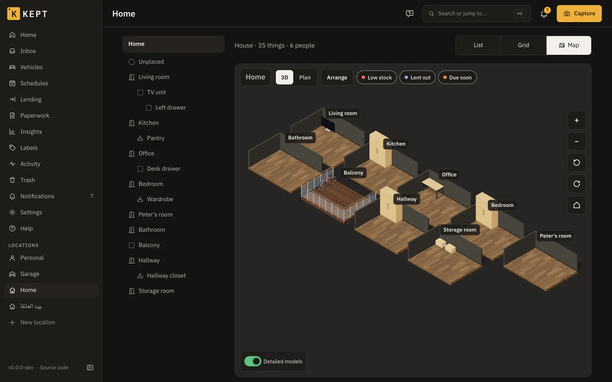
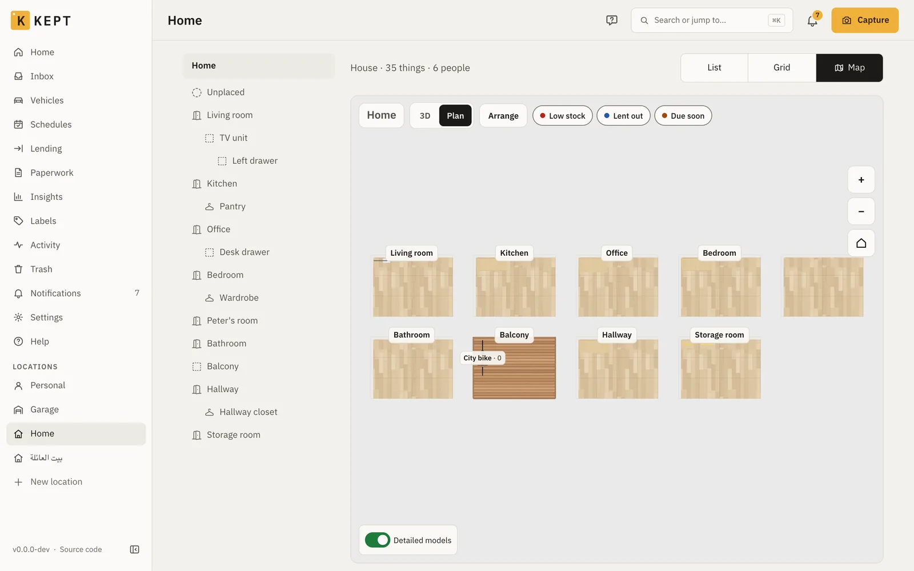
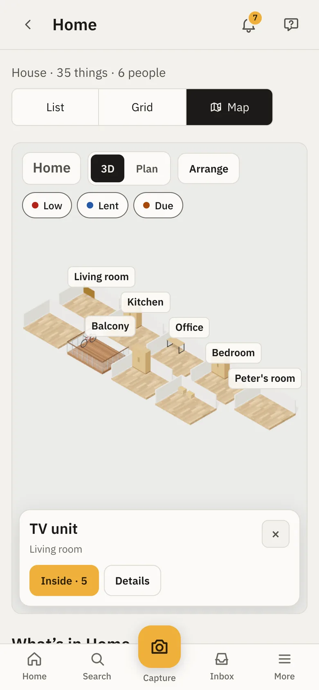
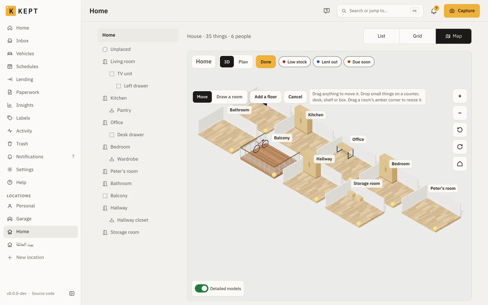

import Clip from '../../../components/Clip.astro';
import clipMp4 from '../../../assets/clips/map-add-tv.mp4?url';
import clipPoster from '../../../assets/clips/map-add-tv-poster.webp?url';
import clipWebm from '../../../assets/clips/map-add-tv.webm?url';

A location's page has three layouts: **List**, **Grid** and **Map**. The map draws the location
in 3D: each floor, its rooms, and the shelves, cupboards and boxes in them. Tap anything to see
what it is, where it is and what's inside. List stays the default; Kept remembers your choice for
each location on each device. In Map, the map leads and fills the screen; the location's
buttons (Print inventory, Print labels and the rest), **Add here** and **Unplaced** follow it.

To see it before installing anything, [try the map](/try/map/) with a sample home in your browser.

The map needs a connection: it isn't part of the phone's offline copy. It loads only when you open
it, so the rest of Kept stays as quick as before.

## What's on the map

| On the map | Where it comes from |
|---|---|
| **Floors** | Places of the kind **Floor** at the top of the location. With none, the location is one level. |
| **Rooms** | Every place directly on a floor (or at the top, when there are no floors), whatever its kind. |
| **Shelves, cupboards, areas** | The places directly in a room. |
| **Boxes and other containers** | The containers directly in a room. |
| **Anything else** | A thing you put on the map yourself, such as the TV or the car. |

Names never overlap or get cut off: when two would touch, the room's name stays and what's in a
shelf or box shows once you zoom in far enough. The thing you selected always keeps its name.

Everything else is counted: a shelf says how many things are on it, and its card lists them.
Nobody has to arrange anything first. Rooms nobody arranged are laid out side by side in the
order of the places list, and what stands in them in rows. A room called "Garden", "Balcony" or
"Terrace" is drawn as one.

Pins show what needs attention: **Low stock** (Consumables), **Lent out** (Lending) and **Due soon**
(schedules, warranties and documents). A pin sits on the shelf or box that holds the thing. The
chips at the top turn each kind on or off.

## Moving around

| | With a mouse | On a phone |
|---|---|---|
| Pan | Drag | Drag with one finger |
| Zoom | Scroll, or **+** and **−** | Pinch, or **+** and **−** |
| Turn | The turn buttons | Turn with two fingers, or the turn button |
| Open a room | Double-click it, or **Open** on its card | Double-tap it, or **Open** |
| Back | The location's name or the floor at the top, or the house button | The same |

The floor buttons work like a lift: **R**, **1**, **G** and so on, each named after its floor, and
**All** stacks every floor. On a phone they sit in one row at the bottom with the zoom and turn
buttons, and step aside while a card is open. **Plan** looks straight down, with names and what's
in each shelf. Stairs on the map take you to the floor above or below.

## The card

Tapping something opens a short card: its name, where it is, its short ID and anything due.
**Details** adds its photo, its label (the same QR code a printed label carries), its facts and
**Open the thing** or **Open the place**. **Inside** lists what's in it; tap one to see it. With a
mouse, hovering shows the name and short ID without a click.

## What's in the location

Under the map, **What's in** lists every room with what stands and lies in it. Search by name or
short ID, pick a floor, or switch to **Needs attention** for everything low, lent out or due. A tap
shows it on the map. The search, the floor and the view are in the address, so you can share or
bookmark them.

For screen readers and keyboards, **Places on this level** lists the floor's rooms and what stands
in them, beside the map.

## Arranging

Owners, admins and members can arrange a location; viewers see it as arranged. **Arrange** starts:

- **Move**: drag anything. Small things (a laptop, a lamp, a box) can stand on a counter, desk,
  shelf or box, and move with it. Drag a thing into another room to move it there in Kept too.
- Drag a room's **amber corner** to resize it. Rooms on a floor can't overlap.
- **Draw a room** on empty ground. It becomes a new place on that floor straight away.
- **Add a floor** adds a place of the kind Floor, with one room in it.
- Select a room to set its **kind** (room, balcony, terrace, garden) and its **floor** (wood, tiles,
  concrete, deck, grass), or to **put a thing of that room on the map**.
- Select a thing to **turn** it, change its **shape** (see below), or **take it off the map** (only
  what you put there yourself).

**Done** saves the whole arrangement at once, and the toast offers **Undo** for ten minutes.
**Cancel** puts the map back. If someone else arranged the same location while you were, Kept
says so and shows theirs, rather than overwriting it.

The arrangement travels in a Kept export, so moving to another server keeps the map. A Homebox
import starts from the automatic layout.

## Put things on the map

Shelves, cupboards, areas and boxes standing directly in a room are on the map already. Anything
else, such as the TV, a desk or the car, is on the map once you put it there. Owners, admins and
members can do it.

### In a room you already have

1. Open the location and choose **Map**.
2. Select the room: tap its floor, or tap it in **What's in** under the map. To work closer,
   **Open** on its card goes into the room.
3. Tap **Arrange**. The room's card now has **Put on the map**, listing the room's things that
   aren't on the map yet.
4. Type part of the name or the short ID in **Find a thing in** the room, then tap the thing. It
   appears in the middle of the room, selected.
5. Its card says which shape it got and why: **Shape: TV, from its type** or **from its name**.
   When Kept isn't sure, the card says **a guess** and shows **Pick a shape**.
6. **Change** (or **Pick a shape**) opens the shapes. **Suggested** comes first, then every shape
   in its group (furniture, storage, electronics, kitchen and laundry, tools, plants and outdoor,
   vehicles, stairs and areas), each with a picture. **Find a shape** searches the names and their
   other words in any of Kept's languages: "fridge", "Kühlschrank" and "ثلاجة" all find the
   fridge. Tap a shape to use it.
7. Drag the thing where it stands. Small things can stand on a desk, counter, shelf or box.
   **Turn** turns it a quarter.
8. Tap **Done**. The toast offers **Undo** for ten minutes. **Cancel** before Done throws the whole
   session away.

<Clip
  webm={clipWebm}
  mp4={clipMp4}
  poster={clipPoster}
  width={960}
  height={698}
  label="Putting a TV on the map in the sample household: Arrange, the living room, Put on the map, the Samsung TV, its card saying Shape: TV, from its type, the shape picker with Suggested first and a search for Fernseher, then a drag towards the wall and Done."
  caption="Putting the TV on the map in Try Kept's sample household. The card says the shape came from its type; the picker shows Suggested first, and a search in German finds the TV."
/>

### How Kept picks the shape

- **From the type first.** A thing whose type is TV, car, bicycle, motorbike or box gets that
  shape straight away. A type that only narrows it down (electronics, an appliance, a tool) puts
  the likely shapes first in **Suggested** and leaves the choice to you. A type you made yourself
  counts by its name: a type called "Television" works like the TV type.
- **Then the name**, word by word, in English, Arabic, French, German and Italian, with common
  other words ("couch", "telly", "Kühlschrank", "تلفزيون"). A name that points at one shape
  ("Samsung TV") gets it by itself; one that could be two ("Screen": a TV or a monitor) is a guess.
- **Nothing fits?** Things with no shape of their own, such as a webcam, a router, a speaker or a
  games console, are suggested the **Small device**, the size of a gadget. Anything else starts as
  the **Small thing**.
- **Your choice stays.** Kept never changes a shape someone picked, and things already on the map
  keep theirs.

### In a location with no rooms yet

An office or a storage unit often starts with everything in **Unplaced** and no rooms, so its map
is empty ground.

1. Open the location, choose **Map** and tap **Arrange**.
2. Choose **Draw a room** and drag on the empty ground. The room is a new place in Kept straight
   away, named Room 1; rename it from **Open the place** on its card.
3. Tap **Done**.
4. Give the things a place in that room. On the location, **Sort them** goes through Unplaced one
   thing at a time with a place picker; or open a thing and use **Actions → Move**.
5. Back on the map, put them on it as above: **Arrange**, the room, **Put on the map**.

### What Unplaced means here

**Unplaced** holds the things that have no place yet. They are in no room, so they aren't on the
map and **Put on the map** doesn't list them. Give a thing a place in a room first; it then shows
up in that room's list.

## Detailed models

Furniture, plants and outdoor AC units are drawn with free models from
[Poly Haven](https://polyhaven.com) (CC0), shrunk for phones: about 150 KB each at most, about
1.5 MB for all of them, and only the floor in view loads its own. Everything else is drawn by Kept
itself. Turn off **Detailed models** under the map and nothing is downloaded at all; Kept
remembers that on this device.

If the browser can't draw 3D (an old phone, or graphics turned off), the map says so and the list
under it still has everything.
