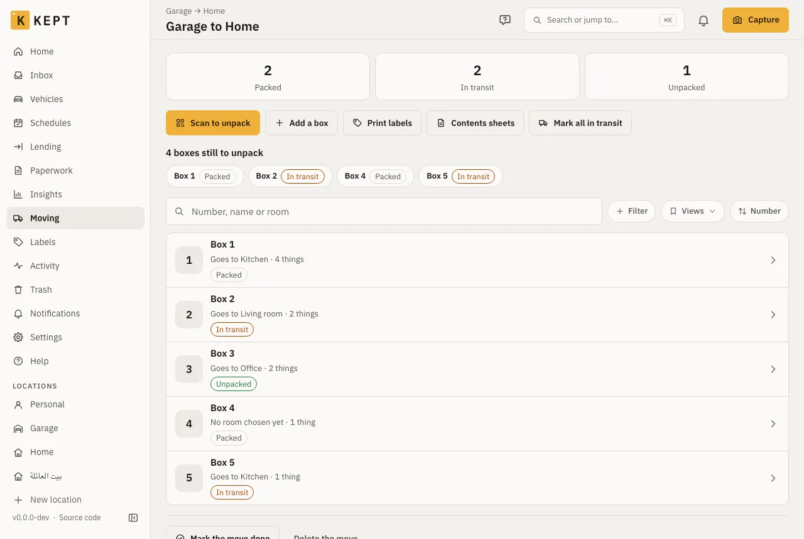
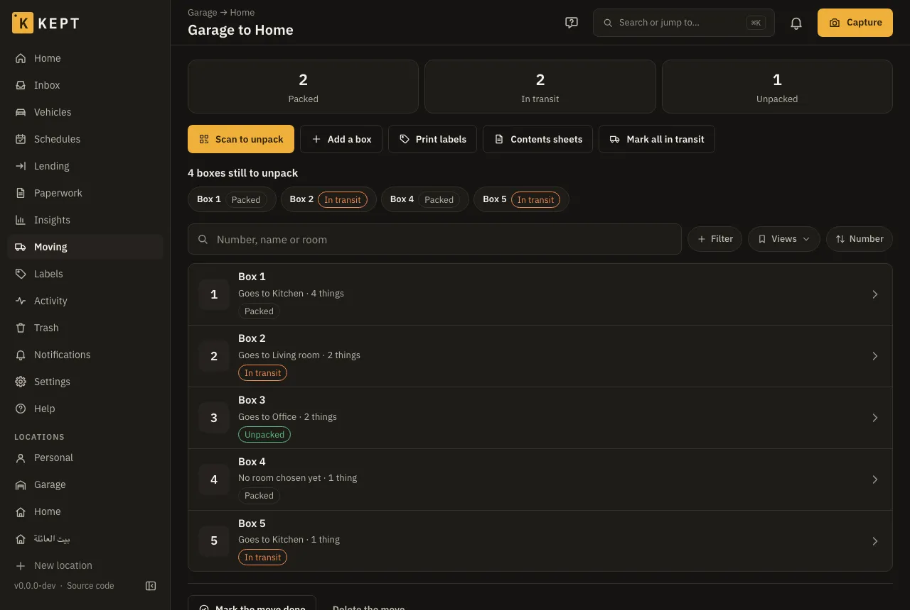
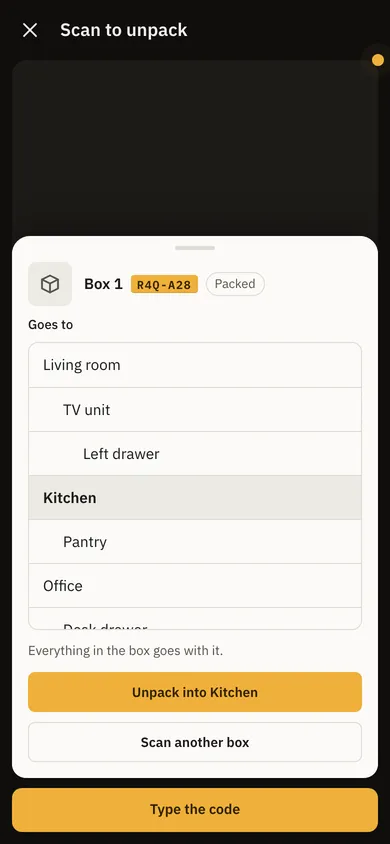

**Moving** packs a home into numbered boxes and unpacks them at the other end. Each box is an
ordinary Kept box, so what you put in it stays findable the whole way: search for the kettle and
Kept says **Box 7**. At the new home, scan a box's label, choose the room, and the box and
everything in it move there in one go.

It works on a phone with no signal, which is most of moving day.

## Turn it on

Moving is part of the **Complete** preset. For any other location, an owner or admin turns on
**Moving house** in **Location settings → What to track**. It needs **Labels and QR codes**,
which every preset has. Its entry, **Moving**, then shows in the sidebar (on a phone, under
**More**).

## 1. Start a move

1. **Moving → Start a move**.
2. A **name** ("To the new flat"), and where it is **Going to**: another of your locations, or
   the rooms of the same one when you're only reorganising.

Moving to a new home? Add it as a location first, with its rooms, so each box can go straight
into its room.

## 2. Pack

- **Add a box** gives the next number: Box 1, Box 2 and so on. Choose the **Room it goes to** now
  if you know it; it is printed on the box's contents sheet, and the unpack starts from it.
- Fill a box from its page: **Open the box** to add things or move them in, or **Pack with the
  scanner**: scan things to pick them up, then the box's label to put them in.
- **Print labels** prints a label for every box (any label sheet Kept supports). Stick one on
  each box, on a side you will see in a stack.
- **Contents sheets** makes a PDF with a page per box: its number, the room it goes to, what's
  inside and its code. Tape it to the box; the code on it scans like the label.

## 3. In the van

**Mark all in transit** when the boxes are loaded, or mark one box at a time from its page.

The board leads with the counts (**Packed**, **In transit**, **Unpacked**) and lists the boxes
**still to unpack**, so you can see at the other end which ones haven't turned up. Search, filter
and group the boxes by state or by room.

## 4. Unpack

1. **Scan to unpack** on the move, and point the camera at a box's label or its contents sheet.
   (No camera? **Type the code** works the same.)
2. The room it goes to is chosen already; change it if you like.
3. **Unpack into Kitchen**. The box, and everything in it, is now in the kitchen of the new home.
   Scan the next box straight away.

**Undo** on the message puts the box back where it was. When every box is unpacked, **Mark the
move done**; **Open it again** if a box turns up later.

## Offline

On a phone, a move you have opened once is kept for offline use. Without a connection you can
still read the board and each box's contents (as of the last time it was read), pack, mark boxes
packed or in transit, and unpack them. Those changes wait on the phone, are shown at once, and
sync when it's back online. If two phones change the same box while offline, the change made
last wins.

Starting a move, adding a box, choosing a box's room, the contents sheets and marking the move
done need a connection.

## Who can do what

| | Viewer | Member | Admin and owner |
|---|---|---|---|
| See moves and their boxes | Yes | Yes | Yes |
| Make the contents sheets | Yes | Yes | Yes |
| Start a move, add boxes, pack, mark and unpack | | Yes | Yes |
| Delete a move (its boxes stay, as boxes) | | Yes | Yes |

Unpacking into another location needs you to be able to add things there too. Each change is in
the box's history and the location's activity.

A Kept export doesn't hold moves: the boxes and everything in them are exported as things, where
they are.
